# AVA Mr. Do

[](https://github.com/Harlock123/AVAMrDo/actions/workflows/build.yml)

A digging game in the style of Universal's 1982 arcade game **Mr. Do!**, built with .NET 10 and
Avalonia UI. A clown tunnels through a garden of earth after the cherries, with monsters coming
after him down every tunnel he digs. Drop apples on them, or throw the power ball that rolls along the
tunnels to find one.

## Features

- **Digging**: the clown digs wherever he goes, slower through earth than along a tunnel. Tunnels side by side stay walled apart until he digs through, and the monsters can only follow where he has dug.
- **Cherries**: four clusters of eight in every garden, 50 points each. Eat a whole cluster without stopping for a 500 bonus.
- **Apples**:
  - **Falling:** dig out beneath one and it wobbles, then drops, crushing anything below for 1,000, 2,000, 4,000… for each one caught.
  - **Breaking:** an apple that falls more than a tile breaks, one that drops a single tile stays whole, and any apple blocks the way.
  - **Danger:** stand under one when it comes down and it crushes the clown.
- **The power ball**: throw it and it rolls along the tunnels to the nearest monster it can reach, for 500 points. It takes longer to come back after every throw in a level.
- **Monsters**:
  - **Creeps:** they come out of the nest in the middle of the garden one at a time and take the shortest way through the tunnels to the clown.
  - **Diggers:** a creep that can't reach the clown for a few seconds turns blue and digs straight towards him.
  - **Letter monsters:** now and then one comes out carrying the next letter of EXTRA. Beat it to win the letter.
- **EXTRA**: win all five letters for another clown and the next level.
- **Clearing a level**: eat every cherry or beat every monster the level sends, for a bonus of 1,000 times the level number. Each level has its own earth, cherries and apples, and faster monsters.
- **Extra clowns** at 25,000 points and every 50,000 after that, as well as for EXTRA.
- **Sound**: a bouncy circus march over the play, with digging, the cherry blip, the streak fanfare, the wobble and fall of an apple, the crush, the ball, and the letters. All of it is synthesised and mixed by OpenAL.
- **Attract mode**: leave the title alone for 15 seconds and a computer clown plays. It digs to the nearest cherry, keeps out from under apples, throws the ball when a monster is in reach, and runs when one gets close.
- **A top-ten high-score table** with arcade-style initials entry. It records the level reached.
- **Gamepads** through SDL2, as well as the keyboard.
- **Any window size**: the screen scales to fit, letterboxed. **Ctrl+S** saves a screenshot.
- **One self-contained executable** per platform: Windows, macOS and Linux on Intel/AMD and ARM.

## Screenshots

| The title | Level one | Digging for cherries |
|:---------:|:---------:|:--------------------:|
| 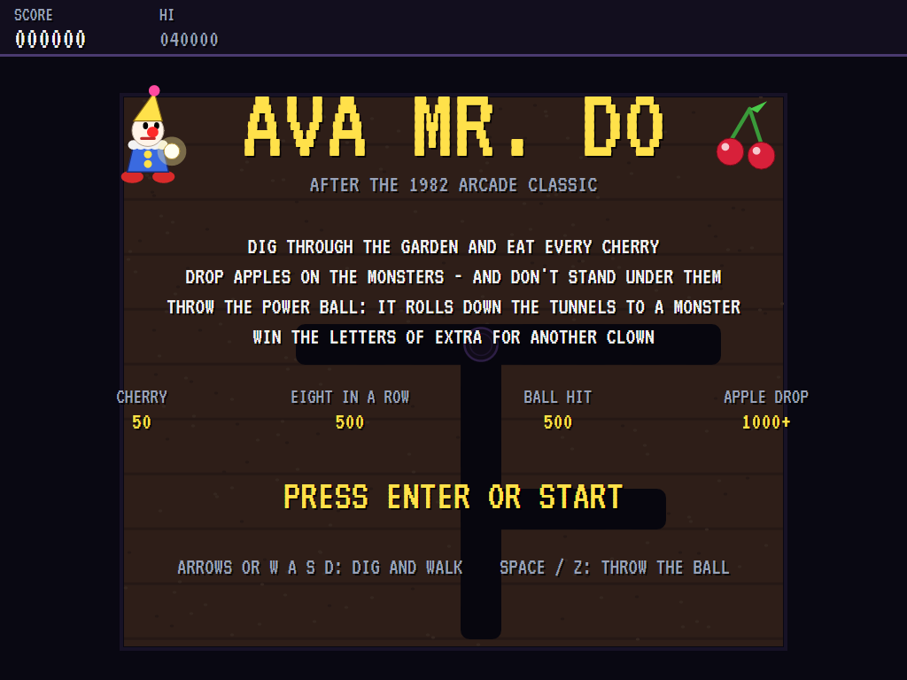 | 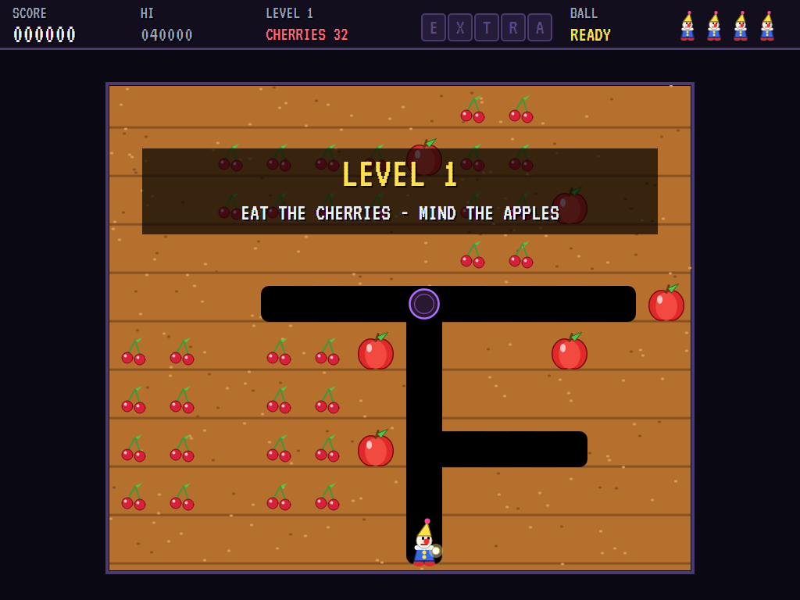 | 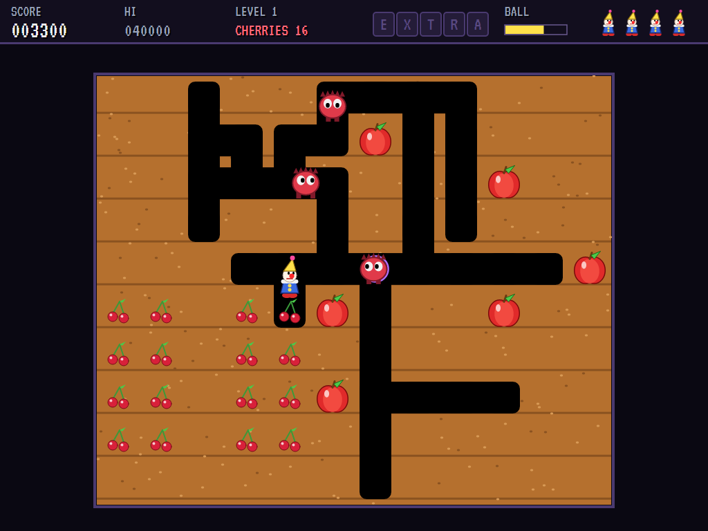 |
| What everything is worth. | The garden before a spade goes in. | Creeps in the tunnels. |

| The power ball | An apple drops | A letter monster |
|:--------------:|:--------------:|:----------------:|
| 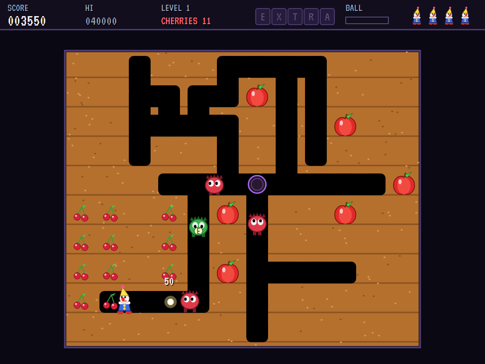 | 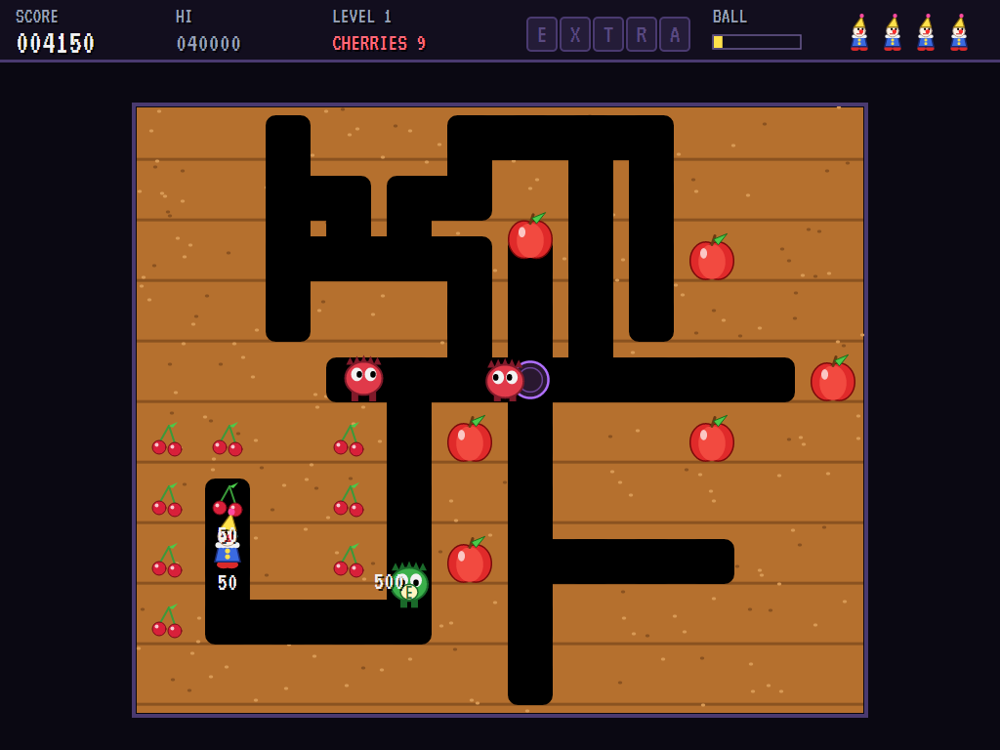 | 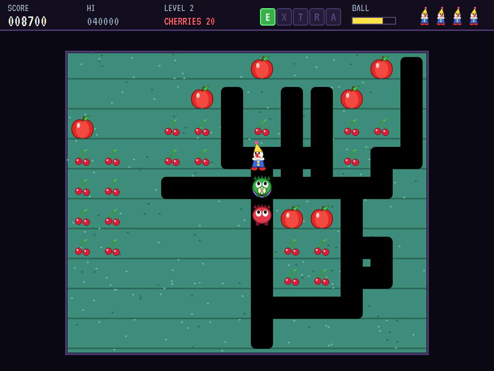 |
| Rolling to a monster. | Dug out from under. | Carrying the E of EXTRA. |

| A digger | Level cleared | Level three |
|:--------:|:-------------:|:-----------:|
| 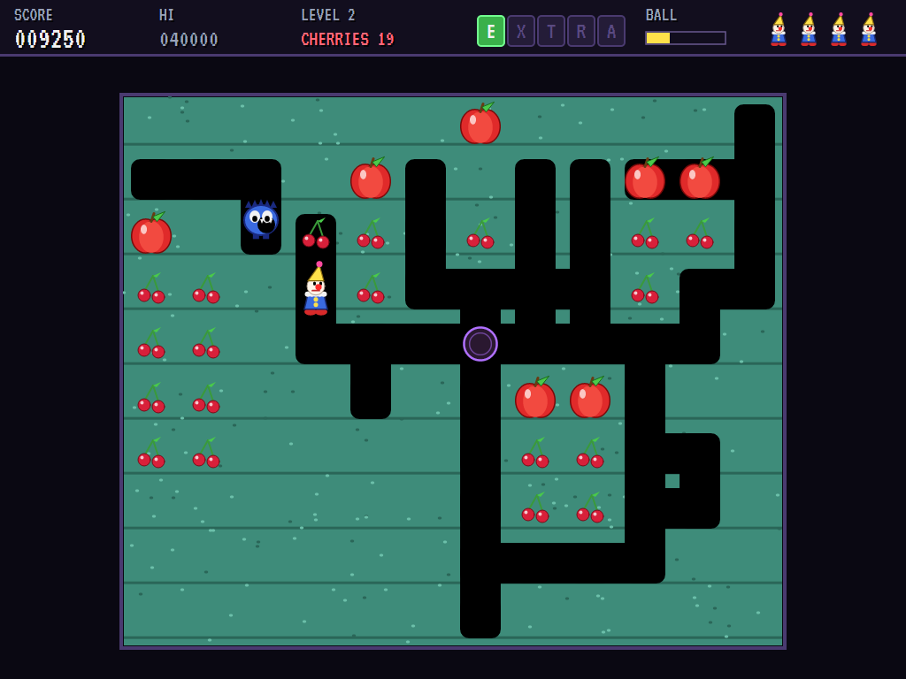 | 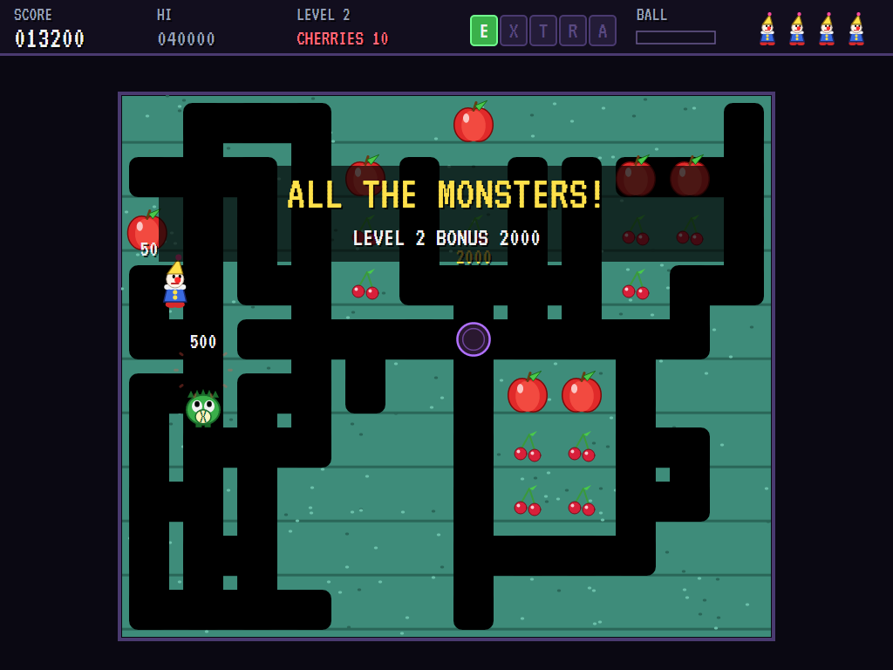 | 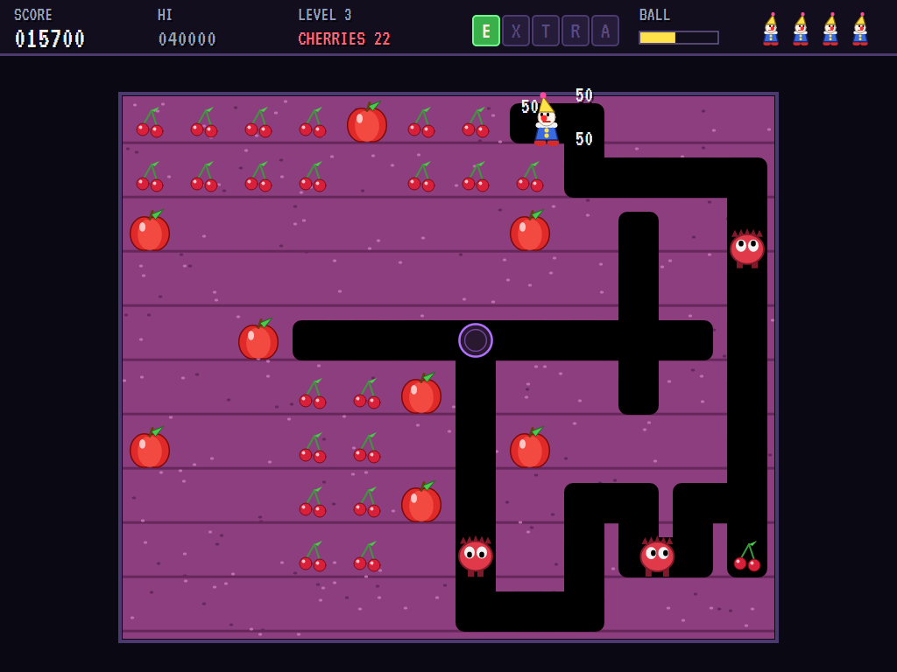 |
| Through the earth. | The bonus. | New earth, new garden. |

| Crushed | The best clowns | |
|:-------:|:---------------:|:-:|
| 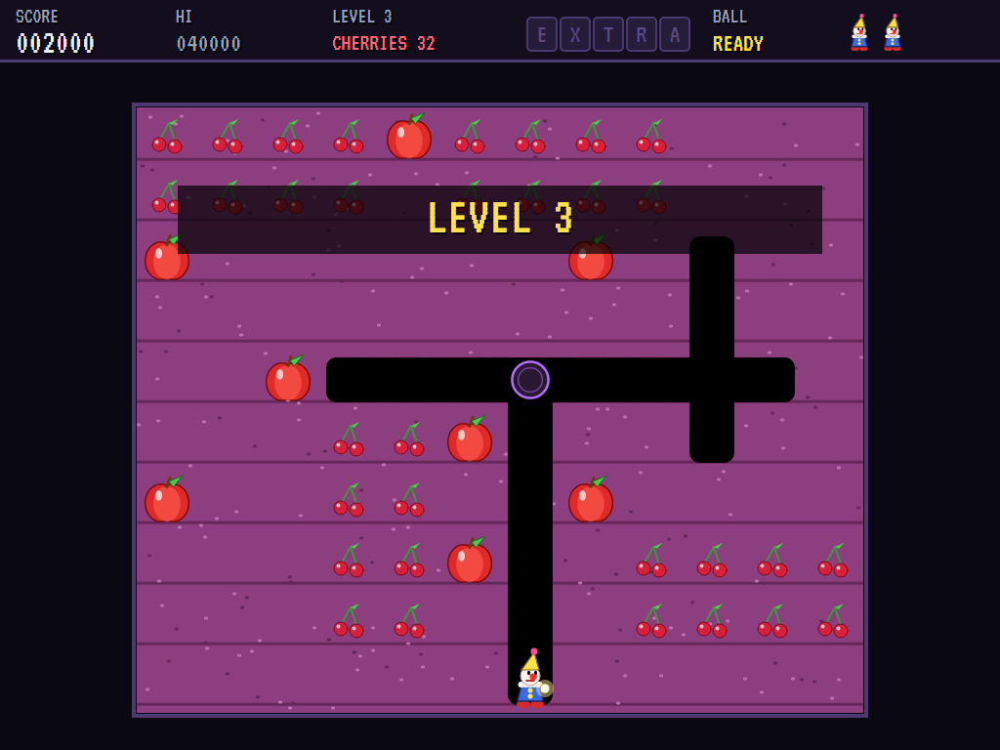 | 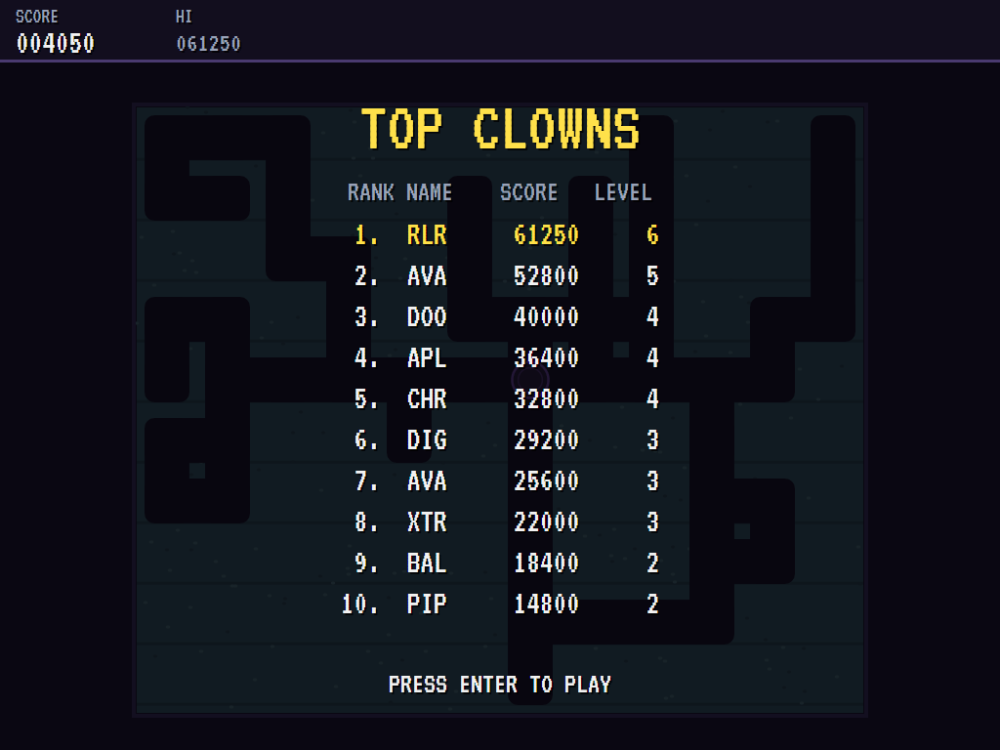 | |
| Don't stand under the apple. | The high-score table. | |

The screenshots are made by the tests, which play the game in a real (headless) window; see
[Tests](#tests).

## Download and run

Ready-to-run builds for Windows, macOS and Linux, on both Intel/AMD and ARM, are on the
[Releases page](https://github.com/Harlock123/AVAMrDo/releases/tag/latest). **Latest build** is
rebuilt on every push to `main`. Each download is one self-contained executable: no .NET install is
needed.

| Platform | Archive |
|---|---|
| Windows | `AVAMrDo-win-x64.zip`, `AVAMrDo-win-x86.zip`, `AVAMrDo-win-arm64.zip` |
| macOS | `AVAMrDo-osx-arm64.tar.gz` (Apple silicon), `AVAMrDo-osx-x64.tar.gz` (Intel) |
| Linux | `AVAMrDo-linux-x64.tar.gz`, `AVAMrDo-linux-arm64.tar.gz`, `AVAMrDo-linux-arm.tar.gz` |

```bash
tar -xzf AVAMrDo-linux-x64.tar.gz     # or linux-arm64, linux-arm, osx-arm64, osx-x64
./AVAMrDo
```

On Windows, unzip and run `AVAMrDo.exe`. On macOS, if Gatekeeper refuses to open it, run
`xattr -d com.apple.quarantine AVAMrDo` once. Run with `--no-audio` for silence.

**Sound** comes through OpenAL Soft, built in for every platform. In a virtual machine the game
detects it and uses a larger audio buffer, so the sound doesn't break up.

**Gamepads** use SDL2, which is bundled for Windows, macOS and Intel/AMD Linux. ARM Linux builds need it
installed; without it the keyboard still works:

```bash
sudo apt install libsdl2-dev            # Debian / Ubuntu / Raspberry Pi OS
sudo pacman -S --needed sdl2-compat     # Arch / Omarchy
```

## Controls

| Input | Action |
|-------|--------|
| **Enter** / **Space** | Start |
| **Arrow keys** or **W** / **A** / **S** / **D** | Dig and walk (the last pressed wins) |
| **Space** / **Z** / **X** / **Ctrl** | Throw the power ball |
| **P** / **Esc** | Pause (Esc again to quit) |
| **M** | Mute |
| **Ctrl+S** / **Cmd+S** | Save a screenshot to the Pictures folder |

**Gamepad**: left stick or D-pad to walk, **A**, **B** or **X** to throw, **Start** to start and pause,
**Back** (while paused) to quit.

**Entering initials**: type letters, or dial with **Up**/**Down** and accept with **Space**; **Left** /
**Backspace** go back; **Enter** finishes.

## Tests

```bash
dotnet test AVAMrDo.slnx
```

The engine has no UI and runs in fixed 60 Hz steps, so it plays the same at any frame rate, and a seed
always plays the same game. The tests check, mostly on a bare garden with things placed where the
test wants them:

- **Digging:**
  - digging slower than walking
  - stopping when the stick is let go, and turning only at a tile centre
  - side-by-side tunnels staying walled apart
  - apples in the way
- **Cherries:** the streak bonus for eight without a pause, and a pause breaking it
- **Apples:**
  - wobbling, then dropping and crushing two monsters for 1,000 and 2,000
  - breaking after a long drop, staying whole after a short one
  - crushing the clown
- **Monsters and the ball:**
  - a creep following the tunnels to the clown, and one with no way through starting to dig
  - the ball rolling to a monster, and taking longer to recharge each time
  - the five letters of EXTRA giving another clown and the next level
- **Levels and clowns:**
  - clearing a level by the cherries or by the monsters
  - a lost clown starting again with the monsters home, and the last one ending the game
  - every level's four clusters of eight and its apples that don't fall at once
- **The machine:** the computer clown clearing the first level, the attract cycle, the same game from the same seed, initials and the high-score file

The screenshot tests draw the real screen in a headless window. To refresh the README's pictures:

```bash
MRDO_SHOTS=$PWD/Images dotnet test tests/AVAMrDo.Tests --filter ScreenshotTests
```

To see how the computer clown gets on, level by level (for tuning):

```bash
MRDO_PROBE=1 dotnet test tests/AVAMrDo.Tests --filter PilotProbe --logger "console;verbosity=detailed"
```

## Building

```bash
dotnet build AVAMrDo.slnx
dotnet run --project src/AVAMrDo
```

Needs the .NET 10 SDK. The sounds are made by `tools/make_sounds.py` (standard-library Python):
`python3 tools/make_sounds.py` rewrites `src/AVAMrDo/Sounds`.

## Project structure

```
AVAMrDo/
├── AVAMrDo.slnx
├── src/AVAMrDo/
│   ├── Engine/
│   │   ├── GameEngine.cs        # States, the title and demo cycle, and the music
│   │   ├── GameEngine.Play.cs   # The garden and its tunnels, digging, cherries and the streak, apples,
│   │   │                        # creeps, diggers and letter monsters, the power ball, levels and scoring
│   │   ├── ClownPilot.cs        # The computer clown, for the demonstration (and the tests)
│   │   ├── Entities.cs
│   │   ├── HighScoreTable.cs, InitialsEntry.cs
│   │   ├── InputHandler.cs, ControllerManager.cs  # Keys and an SDL2 gamepad
│   │   └── SoundManager.cs      # Effects, the march and the tunes through OpenAL
│   ├── Audio/                   # The OpenAL engine (from the author's AVABand)
│   ├── Views/                   # The garden, the clown, the monsters, apples and cherries, and the screens
│   └── Sounds/                  # The synthesised effects and tunes
├── tests/AVAMrDo.Tests/         # Gameplay, screenshot and probe tests
├── tools/make_sounds.py
└── Images/                      # Screenshots
```

## About and licence

AVA Mr. Do © 2026 Lonnie Watson, under the [MIT License](LICENSE).

*Mr. Do!* © 1982 Universal; the name belongs to its current owner. AVA Mr. Do is an independent,
unofficial game in its style. Its clown, monsters, gardens, graphics, sounds, tunes and code are its
own; nothing is taken from the arcade machine's program, graphics, sound or music. It is not affiliated
with or endorsed by any rights holder.
